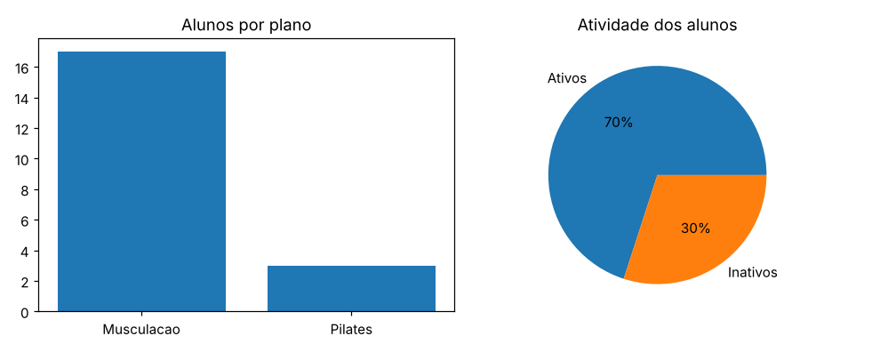

# Gym Management System

A command-line application for managing gym members, written in Python with an SQLite database and Matplotlib charts.

This is a personal learning project I built while studying Computer Science, to practice Python, SQL, CRUD operations, modular code and data visualization. The user interface and the code identifiers are in Portuguese (my native language); this README and the project documentation are in English.

> **Interface language:** Portuguese. *Aluno* = student/member, *plano* = membership plan, *musculação* = weight training, *ativo/inativo* = active/inactive.

---

## Features

**Member management (CRUD)**
- Register a member: name, age, sex, plan (weight training or Pilates), active/inactive status; the enrollment date is recorded automatically
- List all members
- Search by name (case-insensitive)
- Edit a member's age or plan
- Delete a member

**Reports**
- Active vs. inactive members (pie chart)
- Total number of members
- Members per plan (bar chart)
- Average age: overall and per plan
- Members by sex, with percentages (pie chart)

**Reliability**
- Input validation: non-numeric values, out-of-range options, blank names and implausible ages are rejected and asked again
- Schema migration: databases created by older versions are upgraded automatically on startup, without losing data
- Parameterized SQL queries throughout
- Clean exit with the *Sair* (exit) option, `Ctrl+C`, or end of input
- Reports and charts handle an empty database

## Tech stack

| Area | Technology |
|---|---|
| Language | Python 3 (standard library + Matplotlib) |
| Database | SQLite via the built-in `sqlite3` module |
| Charts | Matplotlib |
| Tests | `unittest` (standard library; also runs under `pytest`) |
| CI | GitHub Actions |

## Getting started

Requirements: Python 3.10 or newer and `pip`.

```bash
git clone https://github.com/mateuscengeroff-prog/gym-management-system.git
cd gym-management-system

python -m venv .venv
# Windows: .venv\Scripts\activate
source .venv/bin/activate

pip install -r requirements.txt
```

### Optional: load fictitious demo data

```bash
python scripts/seed_demo_db.py
```

This creates the database the app will use (`GYM_DB_PATH` if set, otherwise `academia.db`) with 20 invented members (names such as "ana demo" or "bruno exemplo"), so every report has something to show. The script refuses to overwrite an existing database unless you pass `--force`. Other options: `--count N`, `--path FILE`, `--seed N`.

### Run

```bash
python main.py
```

The database file is `academia.db` in the project root (created on first run). To use a different file, set the `GYM_DB_PATH` environment variable:

```bash
GYM_DB_PATH=/path/to/other.db python main.py          # macOS / Linux
$env:GYM_DB_PATH="C:\path\to\other.db"; python main.py  # Windows PowerShell
```

`academia.db` is listed in `.gitignore`: member data stays on your machine and is never committed.

## Example session

Output from a real run against the demo database (enrollment dates vary because the demo data is generated relative to the current date):

```text
1 - Cadastrar aluno
2 - Listar alunos
3 - Buscar aluno
4 - Relatorios
5 - Sair
------------------------------------------
Escolha uma opcao 3
------------------------------------------
              Buscando aluno
------------------------------------------
Digite o nome do aluno Ana Demo
ID: 1
Nome: ana demo
Idade: 56
Sexo: feminino
Plano: musculacao
Status: ativo
Data de matricula: 2026-01-19
------------------------------------------
```

Average-age report (*Relatorios → Informacoes de idades*):

```text
             Media de idades
------------------------------------------
Media geral: 43.5 anos
------------------------------------------
Musculacao: 41.6 anos
------------------------------------------
Pilates: 53.7 anos
------------------------------------------
```

Two of the charts, generated with Matplotlib from the demo database (combined into one image here; the program opens each chart in its own window):



## Architecture

```text
gym-management-system/
├── main.py                     # CLI entry point: menus and program flow
├── lib/
│   ├── inter/                  # terminal I/O: validated input readers, menu, headers
│   └── banco_de_dados/         # data layer: SQLite connection, CRUD, reports, migrations
├── scripts/
│   └── seed_demo_db.py         # generates a demo database with fictitious data
├── tests/                      # automated tests (one temporary database per test)
├── docs/
│   ├── AUDIT.md                # engineering notes: audit findings and fixes
│   └── README.pt-BR.md         # original Portuguese README
└── requirements.txt
```

The code is split into three layers:

1. **Presentation** (`main.py`): shows the menus, calls the input readers and the data layer, and draws charts.
2. **Input/output helpers** (`lib/inter`): every value typed by the user goes through a reader that validates it and asks again until it is valid.
3. **Data access** (`lib/banco_de_dados`): each function opens a connection, runs a parameterized query, closes the connection, prints the result for the CLI and returns it, which is what makes the layer testable.

On startup, `criarBanco()` creates the `alunos` table if it does not exist and `atualizarBanco()` applies migrations. Each migration checks the current state before changing anything, so running it again is harmless.

```sql
CREATE TABLE alunos (
    id             INTEGER PRIMARY KEY AUTOINCREMENT,
    nome           TEXT,     -- stored in lowercase
    idade          INTEGER,
    sexo           TEXT,     -- 'masculino' | 'feminino'
    plano          TEXT,     -- 'musculacao' | 'pilates'
    status         TEXT,     -- 'ativo' | 'inativo'
    data_matricula TEXT      -- ISO date, added by a migration
);
```

## Running the tests

```bash
python -m unittest -v
```

The suite has 51 tests covering CRUD operations, every report (including on an empty database), schema creation and migration of an older database, invalid-input handling, the demo-data script, a complete scripted CLI session, and real runs of `main.py` as a separate process. Each test uses its own temporary database, so your `academia.db` is never touched. Charts are rendered with Matplotlib's non-interactive backend, so no windows open.

GitHub Actions runs the same suite on Python 3.10 to 3.13 for every push and pull request.

## Known limitations

These are deliberate scope limits of a learning project, documented rather than hidden:

- **Members are identified by name** when searching, editing and deleting. If two members share a name, an edit or delete affects both (the program reports how many records changed). Using the numeric ID would be the next step.
- Single-user, local SQLite database; no authentication.
- Only two plans (weight training and Pilates) and two values for sex, as in the original design.
- *Editar aluno* (edit member) is located in the reports menu.

## Project history

- **July 2026:** first version, built as a study project.
- **October 2026:** hardening pass to make the project runnable and reviewable by others: fixed a startup crash and several runtime bugs, added input validation, a demo-data generator, automated tests, CI and this documentation. Details in [docs/AUDIT.md](docs/AUDIT.md).

## Author

**Mateus Engeroff**: [GitHub @mateuscengeroff-prog](https://github.com/mateuscengeroff-prog)
